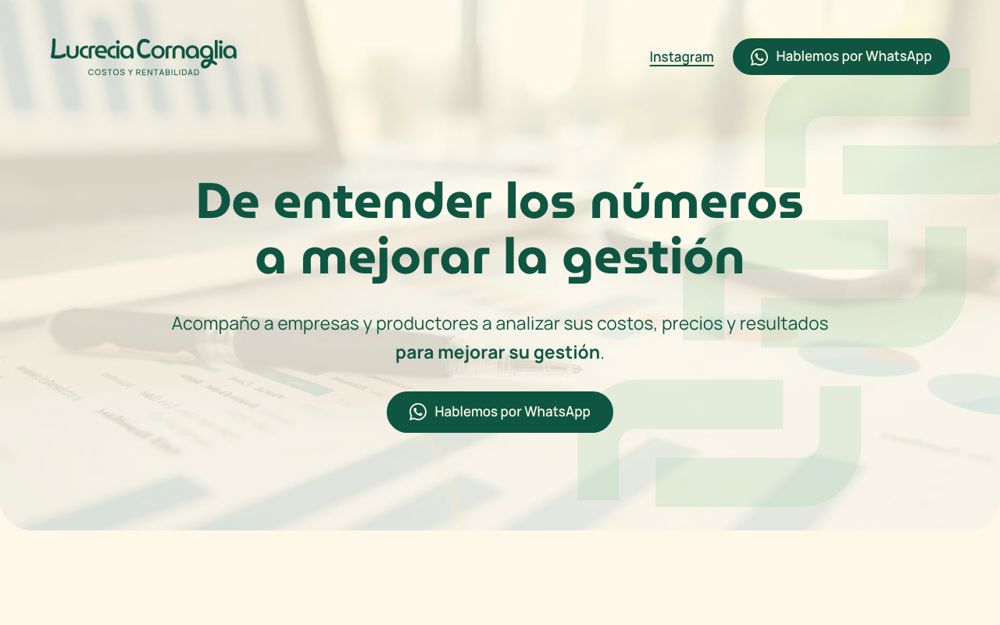

# Lucrecia Cornaglia · Costos y rentabilidad

Website for Lucrecia Cornaglia, a public accountant in Córdoba, Argentina, who helps businesses and farmers understand their costs, prices and margins.

**Live:** [lucreciacornaglia.vercel.app](https://lucreciacornaglia.vercel.app)

| Link-in-bio                                                                                    | Landing                                                                                   |
| ---------------------------------------------------------------------------------------------- | ----------------------------------------------------------------------------------------- |
|  |  |



## What it is

Two pages, both in Spanish for her clients:

- **`/`** is the link-in-bio page her Instagram points to. From there, people go to the landing, WhatsApp or Instagram.
- **`/sobre-mi`** is the landing: who she is, what she does, who she works with, how she works, and a way to get in touch.

Every call to action opens a WhatsApp chat with a prefilled message.

## Process

1. **Brand identity.** I designed her brand and wrote its manual: palette, typography, isotype and graphic elements.
2. **Figma.** Layouts for both pages, mobile and desktop.
3. **HTML/CSS prototype.** I iterated on copy and layout with the client before writing any React.
4. **Next.js.** I ported the approved prototype one-to-one, then checked it against screenshots of the prototype at phone and desktop widths.

## Key decisions

- **Next.js for a static site.** Both pages are prerendered, so visitors get static HTML. I chose the App Router, without `output: 'export'`, so a contact form, more pages or a blog can be added later without migrating.
- **CSS Modules plus a token file, not Tailwind.** The design came from a hand-written prototype built on the brand's tokens:
  - `globals.css` maps the brand manual one-to-one (colours, type scale, spacing).
  - Each section keeps its styles in its own module.
- **Fonts served from the site itself** with `next/font`. Visitors' browsers never request Google Fonts.
- **One SVG sprite with typed icon names.** `<Icon name="…">` only accepts names from `icon-names.ts`, and a test checks that the sprite parses and defines every one of them.
- **Contact details in one module** (`src/lib/site.ts`). The tests pin the literal WhatsApp and Instagram URLs, so a typo fails CI instead of reaching a client.
- **Security headers:** a Content Security Policy, `frame-ancestors 'none'`, `nosniff`, a referrer policy, a permissions policy, and no `X-Powered-By`.
  - The trade-off: `script-src` allows `'unsafe-inline'`, because Next inlines its hydration data into static pages.
  - Nonces would force every request to render on the server, and hash-based SRI is still experimental.
  - With no user-generated content, the XSS surface this leaves is minimal.
- **Accessibility:**
  - semantic landmarks and headings;
  - a focus ring whose colour adapts to dark sections;
  - decorative images and icons hidden from screen readers;
  - the isotype animation turns off for people who ask for reduced motion.
- **Cache Components (the Next 16 default).** Prerendering forbids a bare `new Date()`, so the footer year comes from a `'use cache'` function.

## Quality

- **CI** (GitHub Actions) runs on every push and pull request: lint, type check, Prettier, production build and end-to-end tests.
- **24 end-to-end tests** (Playwright + axe) run against the production build. Setting `BASE_URL` points the same suite at the live site. They cover:
  - every contact link points to the real accounts;
  - the slogan and title read exactly as the client wrote them;
  - nothing overflows a 360px screen;
  - reduced motion is honoured;
  - the sprite is valid;
  - the 404 page, metadata, sitemap and robots.txt;
  - no serious accessibility violations;
  - no console errors under the CSP;
  - the security headers are present;
  - the focus ring is visible on dark backgrounds.
- **Dependabot** checks for updates weekly. Minor and patch npm updates arrive grouped in one PR.
- **Lighthouse** on production:

  | Page                           | Performance | Accessibility | Best practices | SEO       |
  | ------------------------------ | ----------- | ------------- | -------------- | --------- |
  | `/` (mobile / desktop)         | 100 / 100   | 100 / 100     | 100 / 100      | 100 / 100 |
  | `/sobre-mi` (mobile / desktop) | 99 / 100    | 100 / 100     | 100 / 100      | 100 / 100 |

## Project structure

```
src/
  app/
    page.tsx              link-in-bio
    sobre-mi/
      page.tsx            landing
      _components/        one component and CSS module per section
    not-found.tsx         branded 404
    sitemap.ts, robots.ts, icon.svg, apple-icon.png, opengraph-image.jpg
    globals.css           brand tokens and base styles
  components/             Button, Icon (typed names), Isotype, BackgroundImage
  lib/site.ts             contact URLs and site details
public/sprite.svg         brand shapes and icons
tests/e2e/                Playwright suite
```

## What's next

- Subtle scroll animations.
- Her portrait. The About section already takes an optional photo.
- A LinkedIn link once her profile is live.

## Development

Requires Node 24 (see `.nvmrc`).

```bash
npm ci
npm run dev   # http://localhost:3000
```

CI runs lint, type checks, the production build and end-to-end tests on every push.
